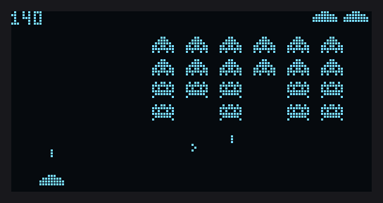

# Clip Jam Hacking

Custom firmware for the **SanDisk Clip Jam** MP3 player (Actions Semiconductor ATJ2127,
MIPS32 4KEc with MIPS16e).

## The headline feature: Sky Raiders, a new game in the main menu



**Sky Raiders** is an original invaders-style shooter written in C and compiled to native
MIPS32 code. The patched firmware adds it as a new **"Raiders" entry in the main menu**, with
its own icon, next to all the stock entries (Books included). It also adds a
**"Raiders: On/Off"** switch under *Settings → System Settings → Customize*, so it can be
hidden like any other menu item.

- 4×7 alien formation that speeds up as it thins, alien shots, 3 lives, score, faster waves
- a calibration screen at start-up: press the keys you want for LEFT, RIGHT and FIRE
- real-time at 30 fps on the player; any other key quits back to the main menu

The screenshot is the game's real framebuffer from the Mac test harness, which compiles the
same `raiders.c` (see [docs/writing-native-code.md](docs/writing-native-code.md)), scaled up
4× (the blue tint and pixel grid are only for the picture).

> **Fully vibe coded, verified on hardware.** Every tool, patch and program here, and the
> reverse engineering behind them, was written with an AI coding assistant (Claude Code).
> Every build listed as working was flashed to and tested on a real Clip Jam; the failures
> are recorded in [docs/flashing-and-recovery.md](docs/flashing-and-recovery.md).

## What else is here

- tools to decrypt, unpack, modify and re-pack the official `upgrade.hex` firmware, with
  every checksum recalculated so the stock updater accepts it;
- notes on the firmware formats and on the runtime the apps run in (app layout, banks,
  system calls, settings storage, UI resources and menus), all worked out by reverse
  engineering;
- two more native programs: a full-screen 1-bit video (frame) player and a real-time 3D
  wireframe cube;
- the patch set behind the menu entry, reusable for your own app.

Everything has been tested on a real Clip Jam running firmware **1.16** (the standard
model, not the "E" model).

> **Stock firmware archive.** The unmodified SanDisk firmware (1.16 and 1.15) is kept in
> [`firmware/`](firmware/) for archival purposes, in case SanDisk removes the downloads.
> It is SanDisk's and is not covered by this repository's licence. Files extracted from
> it (`out*/`) and modified images are not committed (see `.gitignore`).

## Contents

| Path | What |
|---|---|
| [`docs/`](docs/) | Technical write-ups (start with [docs/README.md](docs/README.md)) |
| `tools/` | Python tools: decrypt / unpack / pack, disassembler, resource extractors, patch scripts |
| `programs/` | On-device C programs (`player.c`, `cube.c`, `raiders.c`), linker scripts, host test harness |
| `firmware/` | Archived stock SanDisk firmware (1.16, 1.15) with SHA-256 sums |
| `menu/` | Settings-app additions for the Customize row (`toggle.c`) |

## Status

| Feature | State |
|---|---|
| Decrypt / unpack / re-pack firmware (byte-identical round trip) | ✅ |
| Modified firmware accepted by the stock updater | ✅ |
| Resource edits (strings, icons) | ✅ |
| Running native C code (MIPS32) on the device | ✅ |
| Full-screen 1-bit video player (frames stored in firmware) | ✅ (tested with synthetic frames) |
| Real-time 3D wireframe cube | ✅ |
| **Sky Raiders game** (calibrated controls, 30 fps) | ✅ |
| **Sky Raiders main-menu entry** + Customize on/off row | ✅ (labels in English only) |
| Sound from custom code | ❌ not explored |
| Using the built-in video player (`video.ap`) | ❌ rejects every file; not adapted to this screen |

## ⚠️ Read this first

Flashing modified firmware can leave your player unable to boot. Before you try anything:

1. **Check your model.** *Settings → System Settings → Info*. These notes cover the standard
   model (firmware `1.xx`). Never flash a `1.xx`-based image onto an "E" model (`0.0xE`).
2. **Make sure recovery mode works.** Switch the player off, hold **Vol+ and Vol−**, and
   switch it on. The screen shows a firmware-upgrade screen and the player appears on USB
   as `10d6:10d6` (Actions ADFU). To leave it, unplug and hold power for 15 seconds.
3. **Keep the official `upgrade.hex`** (archived in [`firmware/`](firmware/)). Copying it to
   the player restores stock firmware.

None of the images built here modify the bootloaders (MBREC/BREC), which provide recovery
mode. Details are in [docs/flashing-and-recovery.md](docs/flashing-and-recovery.md).

## Requirements

- macOS or Linux with **Python 3** (standard library only)
- **ffmpeg** (only for converting video for the frame player)
- **LLVM/Clang + LLD** with the MIPS target, for the C programs. On macOS:
  `brew install llvm lld`. Apple's own clang does not include MIPS.

## Quick start

```sh
# 0. the official 1.16 firmware is in firmware/ (also at
#    https://downloads.sandisk.com/firmware/clipjam/116/upgrade.hex)
FW=firmware/clipjam-1.16/upgrade.hex

# 1. decrypt + unpack (writes out116/files/* and out116/fwimage/*)
python3 -I tools/fwu_decrypt.py $FW out116
python3 -I tools/fw_unpack.py out116/files/FWIMAGE.FW out116/fwimage

# 2. sanity check: re-pack unmodified -> must be byte-identical to the original
python3 -I tools/fwpack.py $FW out116/files out116/fwimage out116/rt/upgrade.hex
cmp out116/rt/upgrade.hex $FW && echo identical
```

Build the Sky Raiders + menu-entry firmware (what the author runs):

```sh
# compile the game (three sections: two code banks + resident text)
cd programs
LLVM=/opt/homebrew/opt/llvm/bin
$LLVM/clang --target=mipsel-unknown-elf -march=mips32 -Oz -mno-check-zero-division \
  -ffreestanding -fno-builtin -fno-pic -mno-abicalls -G0 -fno-jump-tables \
  -fno-asynchronous-unwind-tables -c raiders.c -o raiders.o
/opt/homebrew/opt/lld/bin/ld.lld -m elf32ltsmip -T two.ld -e raiders --no-undefined -static raiders.o -o raiders.elf
for s in bank bank2 res; do $LLVM/llvm-objcopy -O binary -j .$s raiders.elf raiders_$s.bin; done
cd ..

# compile the Settings additions
cd menu
$LLVM/clang --target=mipsel-unknown-elf -march=mips32 -Os -ffreestanding -fno-builtin \
  -fno-pic -mno-abicalls -G0 -c toggle.c -o toggle.o
/opt/homebrew/opt/lld/bin/ld.lld -m elf32ltsmip -T toggle.ld -e raiders_toggle -static toggle.o -o toggle.elf
$LLVM/llvm-objcopy -O binary -j .text toggle.elf toggle.bin
cd ..

# patch + pack
FW=firmware/clipjam-1.16/upgrade.hex
python3 -I tools/poc12.py out116/fwimage out116/poc12/fwimage \
  programs/raiders_bank.bin programs/raiders_bank2.bin programs/raiders_res.bin menu/toggle.bin
python3 -I tools/fwpack.py $FW out116/files out116/poc12/fwimage out116/poc12/upgrade.hex
```

Then copy `out116/poc12/upgrade.hex` to the **root of the player's internal storage**,
remove any microSD card, eject and unplug. The player updates itself and switches off.

Always verify an image before flashing it: decrypt it again with `fwu_decrypt.py`, unpack
it, and diff against stock. Only the files you meant to change should differ. See
[docs/tools.md](docs/tools.md).

## Documentation

- [docs/firmware-format.md](docs/firmware-format.md): `upgrade.hex` container, encryption, AFI and LFI archives, checksums
- [docs/hardware.md](docs/hardware.md): display, keys, bootloader, memory map
- [docs/app-runtime.md](docs/app-runtime.md): `.ap` layout, code banks, system calls, messages, settings storage
- [docs/resources.md](docs/resources.md): `.sty` (pictures, strings, UI styles), `.mcg` menus, `config.bin`
- [docs/main-menu.md](docs/main-menu.md): how the main menu and *Customize* work, and how the extra entry was added
- [docs/writing-native-code.md](docs/writing-native-code.md): toolchain, linker scripts, pitfalls, host testing
- [docs/programs.md](docs/programs.md): the frame player, cube and Sky Raiders
- [docs/flashing-and-recovery.md](docs/flashing-and-recovery.md): updating, recovery mode, what went wrong along the way
- [docs/tools.md](docs/tools.md): every script in `tools/`

## Credits

- The firmware encryption (ATJ2127 FWU v3) follows the **Rockbox** project's
  `utils/atj2137/atjboottool` (`fwu.c`). `tools/fwu_decrypt.py` and `tools/fwpack.py` are
  Python re-implementations of that algorithm.
- Recovery-mode background: Roman Yepishev's *SanDisk Clip Sport Recovery Mini-HOWTO*,
  ilyakurdyukov/actions_flash, and nfd/atj2127decrypt.

## License

Released into the public domain under **[the Unlicense](LICENSE)**, except for three
files derived from Rockbox's `atjboottool` (Copyright © 2017 Amaury Pouly), which stay
under **GPL-2.0-or-later** ([LICENSES/GPL-2.0.txt](LICENSES/GPL-2.0.txt)):

- `tools/fwu_decrypt.py`
- `tools/fw_unpack.py`
- `tools/fwpack.py`

Each of these has an SPDX header. This project is not affiliated with SanDisk, Western
Digital or Actions Semiconductor. Use at your own risk.
