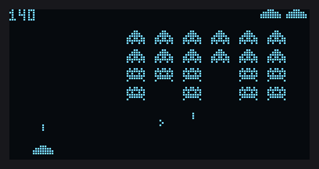

# Programs

All three run as "app 2" (`video.ap`), launched from a main-menu entry (see
[main-menu.md](main-menu.md)) or from the file browser.

## Frame player (`programs/player.c`) ✅

Plays 1-bit 128×64 video stored in `dumy4m.bin`, the 4 MB placeholder inside the firmware.

- **Format** (`tools/frames.py`): a 512-byte header (`"FRMS"`, `u32 frames`,
  `u32 µs per frame`), then 1024-byte frames already in SSD1306 page order. That's up to
  **4,179 frames**, about 3 minutes 40 seconds at 19 fps, uncompressed.
- **Playback:** read a frame with `read()`, copy it to the screen under the LCD lock, and
  keep time with the millisecond timer (a running µs total, so no 64-bit maths). Holding a
  ladder key for 3 frames exits.
- **Size:** 1,163 bytes of MIPS32 in the 0x800-byte bank.

```sh
python3 -I tools/frames.py video.mp4 frames.bin               # fps chosen to fit; --preview DIR for PNGs
python3 -I tools/frames_test.py frames_test.bin 30 20         # synthetic test: border, arrow, ball, seconds counter
python3 -I tools/poc6.py out116/fwimage out116/poc6/fwimage programs/player.bin frames.bin
```

(Tested on the device with the synthetic frames; the timing and orientation are correct.)

## 3D wireframe cube (`programs/cube.c`) ✅

Computed in real time: integer-only rotation around three axes (a Q12 quarter-wave sine
table), perspective projection with the hardware divider, and Bresenham lines into a 1 KB
framebuffer at up to 40 fps. Rotation speed follows the millisecond clock. 1,762 bytes.

Sizing tip: simulate the projection on the host first. The first version was too big for
the 64-pixel-high screen.

## Sky Raiders (`programs/raiders.c`) ✅

An original invaders-style shooter.



- **Controls:** a calibration screen asks for LEFT, RIGHT and FIRE (any ladder keys). Any
  other key held quits to the main menu.
- **Gameplay:** a 4×7 formation that speeds up as it thins, alien shots, 3 lives, score,
  faster waves, and a game-over screen (FIRE plays again).
- **Layout:**

  | Section | Where | Size | Contents |
  |---|---|---|---|
  | `.bank` | `0x4005fe00` | ~1.9 KB | main loop |
  | `.bank2` | `0x4009fe00` | ~1.4 KB | alien logic, calibration, new wave (called once per frame) |
  | `.res` | `0xbfc1ee00` | ~1.6 KB | drawing, font, sprites, input, timing |

- **Host test:** `programs/host_raiders.c` (see writing-native-code.md).

Build commands are in the main README. Package with `tools/poc8.py` (game behind the
Books slot) or `tools/poc12.py` (its own menu entry).

## Not working: the stock video player

The firmware still contains Actions' video player (`video.ap` with `mmm_vp.al`, AVI/AMV,
MJPEG). It can be launched, but it reports "File format not supported!" for every AMV and
AVI tried (ffmpeg AMV at several sizes, MJPEG+PCM/ADPCM AVI). It was never adapted to this
128×64 screen; its graphics are 160 pixels wide. The frame player replaces it.
